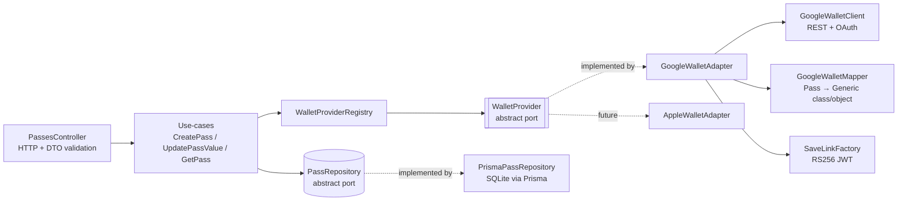

# PassCraft API

A NestJS backend that issues a digital pass to **Google Wallet** and updates it **live** on the phone.

- `POST /passes` with a name, a label and a number returns a **Save to Google Wallet** link (plus a QR code of that link).
- The pass shows the name, the label + number (e.g. **Balance: 40**) and a **QR code with a unique pass ID**.
- `POST /passes/{id}` with `{ "value": 55 }` pushes the new number to Google, and the saved pass on the phone updates without being re-added.
- Built on Clean Architecture: you can add a second wallet platform (e.g. Apple Wallet) **without touching use-cases or controllers**.

Interactive API docs (Swagger) are served at **`/docs`** (OpenAPI JSON at `/docs/json`).

---

## Contents

1. [Architecture](#architecture)
2. [Project structure](#project-structure)
3. [Google Wallet setup (one-time)](#google-wallet-setup-one-time)
4. [Configuration](#configuration)
5. [Run locally](#run-locally)
6. [API usage](#api-usage)
7. [Tests](#tests)
8. [Deploy to Render](#deploy-to-render)
9. [Adding another wallet platform (e.g. Apple Wallet)](#adding-another-wallet-platform-eg-apple-wallet)
10. [Troubleshooting](#troubleshooting)

---

## Architecture



| Layer | Responsibility | Depends on |
|---|---|---|
| **Entity** (`Pass`) | Holds pass data and enforces invariants (non-empty name/label, value 0 – 1,000,000,000) | nothing |
| **Ports** (`WalletProvider`, `PassRepository`) | Abstract classes that act as both contracts and Nest DI tokens | entity |
| **Use-cases** | Application flow: persist → issue → compensate on failure; push-then-persist on update | ports only |
| **Adapters** | Google Wallet API, Prisma; the only code that knows about external SDKs | ports |
| **Controller + DTOs** | HTTP, `class-validator` validation, Swagger | use-cases |
| **Composition root** (`passes.module.ts`) | Wires concrete adapters to ports | everything |

Domain errors (`PassNotFoundError`, `WalletProviderError`, …) are plain classes. `DomainExceptionFilter` maps them to HTTP codes (404, 502, …), so the core never imports HTTP concerns.

### How a pass is issued and updated

1. **Create:** the `Pass` is saved. `GoogleWalletAdapter` makes sure the pass **class** exists (it's created once, then cached), inserts the pass **object** through the Wallet REST API and signs a short "save to wallet" JWT that references that object. If Google rejects the request, the saved row is rolled back.
2. **Update:** the use-case changes the value, `PATCH`es the Google object (`textModulesData`), then persists. Google syncs the object to every device that saved it, so the number changes on the phone.

The pass is a Google Wallet **Generic** pass:

| Pass element | Source |
|---|---|
| Card title | `GOOGLE_CARD_TITLE` (default `PassCraft`) |
| Header | `name` |
| Row on the card front | `label` + `value` (via a class template override) |
| QR code | `uniquePassId` (also printed under the QR) |
| Object id | `<GOOGLE_ISSUER_ID>.<uniquePassId>` |

---

## Project structure

```
server/
├── prisma/
│   ├── schema.prisma                 # Pass model (SQLite; one line to switch to Postgres)
│   └── migrations/
├── src/
│   ├── main.ts                       # bootstrap: CORS, validation, Swagger
│   ├── app.module.ts                 # ConfigModule (Joi-validated) + feature modules
│   ├── app.setup.ts                  # global pipes/filters + Swagger, shared with e2e tests
│   ├── health.controller.ts          # GET /health
│   ├── config/                       # env schema (Joi) and typed config namespaces
│   ├── common/
│   │   ├── errors/domain.errors.ts   # framework-agnostic domain errors
│   │   ├── filters/                  # DomainError → HTTP response
│   │   └── qr/qr-code.service.ts     # QR image of the save link
│   ├── prisma/                       # PrismaService / PrismaModule
│   └── passes/
│       ├── controllers/passes.controller.ts
│       ├── use-cases/                # create-pass, update-pass-value, get-pass
│       ├── interfaces/               # WalletProvider + PassRepository ports
│       ├── adapters/
│       │   ├── wallet-provider.registry.ts
│       │   └── google-wallet/        # adapter, REST client, mapper, save-link signer, types
│       ├── repositories/prisma-pass.repository.ts
│       ├── mappers/pass.mapper.ts    # entity ⇄ DB record ⇄ API response
│       ├── dto/                      # request/response DTOs (validated + documented)
│       ├── entities/                 # Pass aggregate, WalletPlatform enum
│       └── passes.module.ts          # composition root
├── test/                             # e2e spec + fakes (in-memory repo, fake wallet)
├── Dockerfile
└── .env.example
```

---

## Google Wallet setup (one-time)

You need a free **Google Wallet issuer account** (demo/test mode is fine) and a **Google Cloud service account**.

1. **Create an issuer account.** Open the [Google Pay & Wallet Console](https://pay.google.com/business/console), go to **Google Wallet API** and follow the issuer sign-up. Copy your **Issuer ID** (a long number); this is `GOOGLE_ISSUER_ID`.
2. **Enable the API.** In the [Google Cloud console](https://console.cloud.google.com/), select or create a project and enable the [**Google Wallet API**](https://console.cloud.google.com/apis/library/walletobjects.googleapis.com).
3. **Create a service account.** Go to *IAM & Admin → Service accounts → Create service account*, give it a name, then click **Done** (it needs no Cloud roles). Open it, then go to **Keys → Add key → Create new key → JSON**, which downloads a key file.
4. **Authorize the service account in the Wallet console.** In the Pay & Wallet Console go to **Users → Invite a user**, paste the service account email and set the access level to **Developer**.
5. **Add test accounts (demo mode only).** While the issuer is in demo mode, a pass can only be saved by users with Admin/Developer access on the issuer, or by Google accounts added as **test accounts** in the Pay & Wallet Console. Add the Google account used on your Android phone, and the account of anyone else who will test the live URL. Demo passes show a `[TEST ONLY]` prefix.
6. **Copy the key into `.env`:**

   ```bash
   KEY=path/to/service-account.json
   echo "GOOGLE_SERVICE_ACCOUNT_EMAIL=$(jq -r .client_email "$KEY")" >> .env
   echo "GOOGLE_PRIVATE_KEY=\"$(jq -r .private_key "$KEY" | awk '{printf "%s\\n", $0}')\"" >> .env
   ```

   The key is stored on one line with `\n` escapes. The app converts them back to real newlines.

> Never commit the JSON key or `.env`. Both are git-ignored.

---

## Configuration

All environment variables are validated with Joi at startup. If a required variable is missing or malformed, the app exits with a message listing every problem.

| Variable | Required | Default | Description |
|---|---|---|---|
| `PORT` | | `3000` | HTTP port (Render sets this automatically) |
| `NODE_ENV` | | `development` | `development` \| `production` \| `test` |
| `DATABASE_URL` | ✅ | | `file:./data/passcraft.db` (path relative to `prisma/`) |
| `CORS_ORIGINS` | | *(allow all)* | Comma-separated allowed origins for the future web client |
| `PUBLIC_BASE_URL` | | | Public API URL, listed as the server in Swagger |
| `DEFAULT_WALLET_PLATFORM` | | `google` | Platform used when a request doesn't specify one |
| `GOOGLE_ISSUER_ID` | ✅ | | Numeric issuer ID from the Pay & Wallet Console |
| `GOOGLE_SERVICE_ACCOUNT_EMAIL` | ✅ | | `client_email` from the JSON key |
| `GOOGLE_PRIVATE_KEY` | ✅ | | `private_key` from the JSON key (`\n` escapes OK) |
| `GOOGLE_CLASS_SUFFIX` | | `passcraft_generic_v1` | Class id is `<issuer>.<suffix>`. Bump it after changing the class template |
| `GOOGLE_CARD_TITLE` | | `PassCraft` | Title at the top of the card |
| `GOOGLE_LOGO_URL` | | | Optional HTTPS logo image |
| `GOOGLE_BACKGROUND_COLOR` | | `#1a73e8` | Card background colour |
| `WALLET_ORIGINS` | | | Optional origins embedded in the save JWT (sites that render the save button) |

---

## Run locally

Requirements: Node.js 22+ and npm.

```bash
cd server
cp .env.example .env              # then fill in the GOOGLE_* values (see above)
npm install                       # also generates the Prisma client
npx prisma migrate deploy         # creates prisma/data/passcraft.db
npm run start:dev                 # http://localhost:3000, docs at http://localhost:3000/docs
```

To test on your phone during local development, either open the returned `saveUrl` on the phone (send it to yourself) or scan the `qrCodeDataUrl` image with the phone camera. The save link points to Google, not to your machine, so the phone doesn't need to reach localhost.

With Docker:

```bash
docker build -t passcraft-api .
docker run --env-file .env -p 3000:3000 passcraft-api
```

---

## API usage

### Create a pass

```bash
curl -s -X POST http://localhost:3000/passes \
  -H 'Content-Type: application/json' \
  -d '{ "name": "Venu Reddy", "label": "Balance", "value": 40 }'
```

```json
{
  "id": "3f0c6f4e-5b8a-4d55-9a57-2f1f0f7b9c11",
  "uniquePassId": "9d2b1c6a-0e7f-4b3a-8c1d-5e6f7a8b9c0d",
  "name": "Venu Reddy",
  "label": "Balance",
  "value": 40,
  "platform": "google",
  "saveUrl": "https://pay.google.com/gp/v/save/eyJhbGciOiJSUzI1NiIs...",
  "qrCodeDataUrl": "data:image/png;base64,iVBORw0KGgo...",
  "createdAt": "2026-10-15T15:30:00.000Z",
  "updatedAt": "2026-10-15T15:30:00.000Z"
}
```

Open `saveUrl` on an Android phone and tap **Save**.

### Update the number (live)

```bash
curl -s -X POST http://localhost:3000/passes/3f0c6f4e-5b8a-4d55-9a57-2f1f0f7b9c11 \
  -H 'Content-Type: application/json' \
  -d '{ "value": 55 }'
```

`PATCH /passes/{id}` is an alias with the same behaviour.

### Endpoints

| Method | Path | Body | Success | Errors |
|---|---|---|---|---|
| `POST` | `/passes` | `{ name, label, value, platform? }` | `201` pass + `saveUrl` + `qrCodeDataUrl` | `400` validation, `502` wallet API |
| `POST` / `PATCH` | `/passes/{id}` | `{ value }` | `200` updated pass | `400`, `404`, `502` |
| `GET` | `/passes/{id}` | | `200` pass | `400`, `404` |
| `GET` | `/health` | | `200 { "status": "ok" }` | |

Validation rules: `name` is 1–100 chars and `label` is 1–50 chars (both trimmed). `value` is a number from 0 to 1,000,000,000 with at most 2 decimals. Unknown fields are rejected.

Error responses look like:

```json
{ "statusCode": 404, "error": "PassNotFoundError", "message": "Pass with id \"…\" was not found" }
```

---

## Tests

```bash
npm test            # unit: entity, use-cases, registry, Google mapper/adapter/JWT signing
npm run test:e2e    # HTTP: validation, create, update, 404/400/502 (fake wallet + in-memory repo)
npm run lint
```

The tests don't need Google credentials or a database. The e2e suite replaces the ports with fakes in `test/fakes/`, which also demonstrates that the core runs against any adapter.

---

## Deploy to Render

The repo root contains a [`render.yaml`](../render.yaml) blueprint that builds `server/Dockerfile`.

1. Push the repo to GitHub.
2. In Render: **New → Blueprint**, then pick the repo. Render reads `render.yaml`.
3. Fill in the secret env vars when prompted: `GOOGLE_ISSUER_ID`, `GOOGLE_SERVICE_ACCOUNT_EMAIL`, `GOOGLE_PRIVATE_KEY` (the one-line `\n` form from the setup step), and optionally `PUBLIC_BASE_URL` (e.g. `https://passcraft-api.onrender.com`).
4. Deploy. On boot the container runs `prisma migrate deploy` and then starts the API. Check `https://<your-service>.onrender.com/health` and `/docs`.

**Notes for the free plan:**

- The service sleeps when idle, so the first request can take ~30–60 s.
- The disk is ephemeral, so the SQLite data resets on redeploy or restart. Passes already saved stay in Google Wallet, but their `id`s won't be in the new database, so create a fresh pass after a redeploy. For durable data, attach a Render disk mounted at `/app/prisma/data`, or switch to Postgres: set `provider = "postgresql"` in `prisma/schema.prisma`, regenerate the migration, and point `DATABASE_URL` at the database. No application code changes.

---

## Adding another wallet platform (e.g. Apple Wallet)

The core only knows the `WalletProvider` port:

```ts
export abstract class WalletProvider {
  abstract readonly platform: WalletPlatform;
  abstract createPassClassAndObject(pass: Pass): Promise<{ saveUrl: string }>;
  abstract updatePassObject(pass: Pass): Promise<void>;
}
```

To add Apple Wallet:

1. Add `APPLE = 'apple'` to `src/passes/entities/wallet-platform.enum.ts`.
2. Create `src/passes/adapters/apple-wallet/apple-wallet.adapter.ts` extending `WalletProvider`:
   - `createPassClassAndObject`: build and sign the `.pkpass` and return a download URL as `saveUrl`.
   - `updatePassObject`: regenerate the pass and notify devices through APNs (Apple's web-service update flow).
3. Register it in `passes.module.ts`:

   ```ts
   AppleWalletAdapter,
   {
     provide: WALLET_PROVIDERS,
     useFactory: (google: GoogleWalletAdapter, apple: AppleWalletAdapter) => [google, apple],
     inject: [GoogleWalletAdapter, AppleWalletAdapter],
   },
   ```

4. Add its env vars to `src/config/`.

**The controllers, use-cases, DTOs and repository stay unchanged.** Each pass stores its `platform`, so Google and Apple passes can coexist. Clients choose a platform with `"platform": "apple"` on `POST /passes`. Updates are routed to the right adapter automatically.

`updatePassObject` receives the whole `Pass` rather than only `(id, value)` for two reasons. Google's PATCH replaces the `textModulesData` array, so the label must be re-sent. Apple re-renders the entire pass on every change.

---

## Troubleshooting

| Symptom | Cause / fix |
|---|---|
| App exits with `Config validation error` | A required env var is missing or malformed; the message names each one. |
| `502 … invalid_grant` | `GOOGLE_SERVICE_ACCOUNT_EMAIL` and `GOOGLE_PRIVATE_KEY` don't match, or the key was revoked. |
| `502 … permission denied` / `403` | The service account wasn't invited as **Developer** in the Pay & Wallet Console, or `GOOGLE_ISSUER_ID` is wrong. |
| `error:1E08010C:DECODER routines::unsupported` | The private key has broken newlines. Use the one-line `\n` form inside double quotes. |
| "Something went wrong" when saving on the phone | In demo mode, the phone's Google account must be an issuer user or a **test account**. |
| Card layout didn't change after editing the class template | The class is only created once. Set a new `GOOGLE_CLASS_SUFFIX` (e.g. `_v2`). |
| Number doesn't change on the phone immediately | Google pushes updates to the device, usually within seconds to a few minutes. Opening the pass in Google Wallet refreshes it. |
